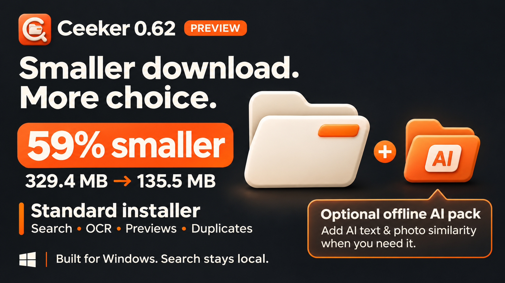

# Ceeker

A Windows file library with local search, document/image OCR, previews, duplicate review and cleanup suggestions.

## 0.62 preview: smaller download

The Standard installer is **135.5 MB**, down from **329.4 MB** (58.9% smaller). It retains normal search, indexed document text, OCR, previews, duplicates, saved searches, Quick Search, tray access and cleanup tools. Optional AI text/photo similarity is a separate **195.9 MB** pack; after installation it works offline. Automatic AI downloading is not configured.

[Download the preview](https://github.com/tenjikusan/Ceeker/releases/tag/v0.62.0-preview.1) · [Installer editions](docs/INSTALLER-EDITIONS.md) · [Validation and remaining checks](docs/VALIDATION-0.62.md)



## Desktop improvements

Global Quick Search (Ctrl+Shift+Space), recent-download tray panel, Playful/Minimal styles, saved live searches, opt-in folder-scoped cleanup rules, Windows automation commands, preview navigation, multi-file drag and responsive layouts. [Details](docs/UI-0.61.md).

## Build

Requires Windows x64 (Windows 10 build 19041 or later), .NET 10 SDK, PowerShell 7, Git and Git LFS. Model binaries are stored using Git LFS.

```powershell
git lfs install
git lfs pull
dotnet build src/Wormy.App/Wormy.App.csproj -c Release -p:Platform=x64
dotnet run --project tests/Wormy.Core.Checks -c Release
```

## Package

Use Inno Setup 6.7+ and a fresh release version. Pass -Compiler with your ISCC.exe path. The retained build-support/performance.json is a historical fixture benchmark, not a new measurement.

```powershell
./scripts/Package.ps1 -Version 0.62.0-preview.1 -Edition Standard
./scripts/BuildInstaller.ps1 -Version 0.62.0-preview.1 -Edition Standard -Compiler 'C:\Program Files (x86)\Inno Setup 6\ISCC.exe'
./scripts/BuildAiPack.ps1 -Version 0.62.0-preview.1 -Compiler 'C:\Program Files (x86)\Inno Setup 6\ISCC.exe'
```

Use -Edition Full to bundle the AI models. Release installers and checksums belong in GitHub Releases; generated files, user libraries and credentials are excluded from source control.

Internal Wormy namespaces, data paths and installation AppId remain for upgrade compatibility. This is a preview: clean-machine, installer upgrade and several native workflow checks remain pending. Signed online updates and checkout remain inactive. No new open-source license grant is made by this upload; [third-party licenses](docs/THIRD-PARTY.md) are retained.
